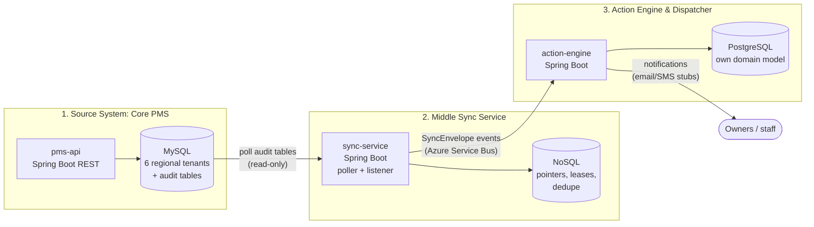
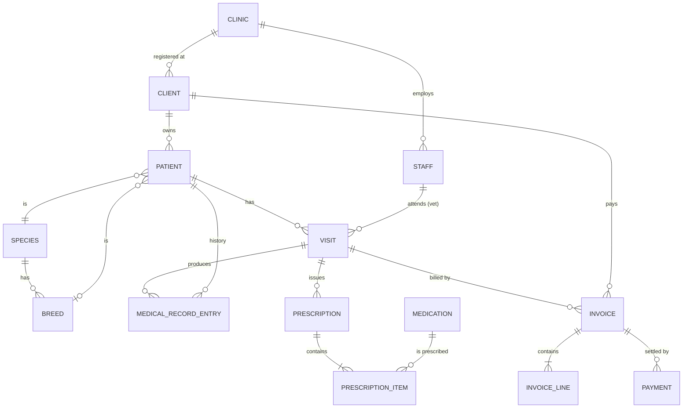

# VetSync POC: Clinic PMS → Sync Service → Action Engine

A proof of concept for a **near-real-time synchronization pipeline** between a veterinary Practice Management System (PMS) and a downstream Action Engine, built with **Java + Spring Boot**, developed **test-first (TDD)**, hosted on **Azure**, and runnable locally on **Windows 11** and **Ubuntu**.

> **How to use this file:** this is the source of truth for humans and coding agents. Read sections 1–3 first, then work through the roadmap (section 12) one phase at a time. Section 14 lists open decisions and things that must be verified rather than assumed.

---

## 1. Goals and non-goals

**Goals**
- Three independently deployable Spring Boot applications with clear contracts between them.
- Test-driven development from the first line of code (red → green → refactor).
- Three environments: `local`, `uat`, `prod`, with the same code and different configuration.
- Runs on Windows 11 and Ubuntu using Docker and Maven.
- Agent-friendly repo: coding agents can build, test, and extend it safely.

**Non-goals (for the POC)**
- Real clinical correctness, real medication catalogues, real e-prescription integrations.
- Real personal data. **Use synthetic data only** (owners' personal data falls under GDPR).
- Full UI. APIs and tests only.

---

## 2. System overview



| # | App | Role | Data store |
|---|-----|------|-----------|
| 1 | `pms-api` | Provides region-scoped REST CRUD, tenant-aware persistence, and trigger-written audit tables. | MySQL (one shared schema, `tenant_id`) |
| 2 | `sync-service` | Reads audit tables and time-window queries, tracks progress, deduplicates, publishes events. | NoSQL (pointers, leases, dedupe) |
| 3 | `action-engine` | Consumes events, maps them into **its own domain**, decides and dispatches actions. | PostgreSQL |

**Key principle:** each app owns its data. The sync service has **read-only** access to MySQL. The action engine never touches MySQL and never imports PMS classes. It only knows the published event contract.

---

## 3. Technology choices

| Concern | Choice | Notes |
|---------|--------|-------|
| Language | Java 21 (LTS) | Java 25 is also LTS; stay on 21 unless there is a reason to move. Verify current guidance. |
| Framework | Spring Boot 3.5.x or newer | **Pin one version in the parent POM; verify the current stable release before starting.** |
| Build | Maven multi-module | Each GitHub Actions workflow installs Maven 3.9.9; the Maven Wrapper remains a scaffold follow-up. |
| Source DB | MySQL 8.4 LTS | Flyway migrations. |
| Sync state | MongoDB locally, Azure Cosmos DB for MongoDB API in UAT/PROD | See open decision D3. |
| Messaging | Azure Service Bus (queue or topic) | Local: Service Bus emulator or RabbitMQ behind an interface. See D4. |
| Action DB | PostgreSQL 16+ | Flyway migrations. |
| Hosting | Azure Container Apps (+ Container Apps **Jobs** for timers) | See D5. |
| IaC | Bicep | Or Terraform if your team prefers. |
| CI/CD | GitHub Actions | Build → test → image → deploy to UAT → manual approval → PROD. |
| Secrets | Azure Key Vault + managed identity | Never commit secrets. |
| Observability | Micrometer + OpenTelemetry → Azure Application Insights | Correlation ID on every event. |

**Test stack:** JUnit 5, AssertJ, Mockito, **Testcontainers** (MySQL, PostgreSQL, MongoDB), Awaitility, WireMock, ArchUnit, JaCoCo. Contract tests between services via Spring Cloud Contract or Pact (see D7).

---

## 4. Repository layout

```
vetsync-poc/
├── README.md                     ← this file
├── AGENTS.md                     ← instructions for coding agents
├── CONTRIBUTING.md
├── SECURITY.md
├── pom.xml                       ← Maven reactor and shared dependency management
├── services/
│   ├── pms-api/                  ← REST API and MySQL-facing adapters
│   ├── sync-service/             ← polling worker and event publisher
│   └── action-engine/            ← event consumer, rules, and dispatch adapters
└── .github/
    ├── copilot-instructions.md
    ├── agents/                   ← planner, implementer, read-only reviewer
    ├── instructions/             ← path-specific Java, workflow, and Markdown guidance
    ├── prompts/                  ← reusable task prompts
    ├── skills/                   ← repeatable development workflows
    ├── ISSUE_TEMPLATE/
    ├── PULL_REQUEST_TEMPLATE.md
    └── workflows/                ← one CI/CD workflow per service
```

Base package: `com.vetsync.<service>` (rename to your organisation's domain). The three Spring Boot applications are separate Maven modules and can be built independently with `mvn -pl services/<module> -am verify`.

Each service has its own hexagonal boundary and deployable container image:

```
services/pms-api/src/main/java/com/vetsync/pms/
├── domain/                  ← PMS entities and business rules
├── application/             ← use cases and ports
├── adapter/in/web/
│   ├── controller/          ← one controller per resource
│   └── dto/                 ← request/response DTOs grouped by resource
├── adapter/out/persistence/ ← MySQL adapters
└── config/                  ← Spring wiring

services/sync-service/src/main/java/com/vetsync/sync/
├── domain/                  ← stream and synchronization rules
├── application/             ← poll/sync use cases and ports
├── adapter/in/scheduler/    ← timer and job entry points
├── adapter/out/mysql/       ← read-only PMS source adapter
├── adapter/out/nosql/       ← progress and deduplication state
├── adapter/out/messaging/   ← event publisher
└── config/

services/action-engine/src/main/java/com/vetsync/action/
├── domain/                  ← action-engine-owned model and rules
├── application/             ← event handling and dispatch use cases
├── adapter/in/messaging/    ← event consumer and contract mapping
├── adapter/out/persistence/ ← PostgreSQL adapters
├── adapter/out/channel/     ← email, SMS, and staff-task channels
└── config/
```

Each workflow builds and tests only its service module (including required Maven modules), then offers an opt-in UAT deployment for a pre-provisioned Azure Container App. Deployment is available only when manually dispatching a workflow with `deploy_uat` enabled. Configure `AZURE_CLIENT_ID`, `AZURE_TENANT_ID`, and `AZURE_SUBSCRIPTION_ID` as `uat` environment secrets, and `AZURE_RESOURCE_GROUP`, `AZURE_ACR_NAME`, `AZURE_ACR_LOGIN_SERVER`, and `AZURE_CONTAINER_APP_NAME` as `uat` environment variables. The GitHub OIDC identity must have permission to push to ACR and update the target Container App.

---

## 5. Environments and configuration

| Env | Where it runs | Databases | Messaging | Purpose |
|-----|---------------|-----------|-----------|---------|
| `local` | Docker Compose on Windows 11 / Ubuntu | Containers | Emulator / RabbitMQ | Development, TDD |
| `uat` | Azure (own resource group) | Managed services, small SKUs, synthetic data | Service Bus | Integration and acceptance |
| `prod` | Azure (own resource group) | Managed services, HA SKUs | Service Bus | Live |

Rules:
- One Spring profile per environment: `application-local.yml`, `application-uat.yml`, `application-prod.yml`. Shared defaults in `application.yml`.
- **Every environment-specific value comes from environment variables** (`${MYSQL_URL}`, etc.). No hardcoded hostnames.
- In Azure, secrets are Key Vault references and services authenticate with managed identity where the service supports it.
- Local secrets live in `.env` (git-ignored). Commit `.env.example` only.
- Tests use the `test` profile plus Testcontainers. They must not depend on `local` Docker Compose being up.

---

## 6. Running locally (Windows 11 and Ubuntu)

**Prerequisites**
- JDK 21 and Maven 3.9.x (the repository does not yet include Maven Wrapper)
- Docker with Docker Compose: Docker Desktop with WSL2 on Windows 11, or Docker Engine on Ubuntu

### Run the PMS API locally

The PMS API has its own MySQL Compose file; the all-services Compose stack described in older project notes is not present. Run these commands from the repository root.

1. Start the local MySQL database:

   ```text
   docker compose -f infra/pms-api/docker-compose.yml up -d mysql
   ```

   Compose uses the local-only database `vetsync`, username `vetsync`, and password `local-only`. Flyway creates the tables automatically when the API starts.

2. Set the required runtime configuration in the same terminal where you will run Maven. Generate a fresh Base64-encoded 32-byte JWT signing key; do not commit it or reuse it outside local development.

   **Windows PowerShell**

   ```powershell
   $key = New-Object byte[] 32
   $rng = [System.Security.Cryptography.RandomNumberGenerator]::Create()
   $rng.GetBytes($key)
   $env:PMS_JWT_SECRET = [Convert]::ToBase64String($key)
   $rng.Dispose()

   $env:DB_URL = 'jdbc:mysql://localhost:3306/vetsync?useSSL=false&allowPublicKeyRetrieval=true&serverTimezone=UTC'
   $env:DB_USERNAME = 'vetsync'
   $env:DB_PASSWORD = 'local-only'
   $env:PMS_BOOTSTRAP_ADMIN_SW_USERNAME = 'admin'
   $env:PMS_BOOTSTRAP_ADMIN_SW_PASSWORD = 'local-only-change-this'
   ```

   **Ubuntu / Bash**

   ```bash
   export PMS_JWT_SECRET="$(openssl rand -base64 32)"
   export DB_URL='jdbc:mysql://localhost:3306/vetsync?useSSL=false&allowPublicKeyRetrieval=true&serverTimezone=UTC'
   export DB_USERNAME='vetsync'
   export DB_PASSWORD='local-only'
   export PMS_BOOTSTRAP_ADMIN_SW_USERNAME='admin'
   export PMS_BOOTSTRAP_ADMIN_SW_PASSWORD='local-only-change-this'
   ```

   The example admin password is for local use only; replace it with a private password of at least 12 characters. The first configured administrator is created only when that tenant has no PMS users. To bootstrap another region, set the corresponding `PMS_BOOTSTRAP_ADMIN_<TENANT>_USERNAME` and `PMS_BOOTSTRAP_ADMIN_<TENANT>_PASSWORD` variables (for example, `..._SE_...` for `se`).

3. Start the API:

   ```text
   mvn -pl services/pms-api spring-boot:run
   ```

   The service listens on `http://localhost:8081`. The first startup applies Flyway migrations; wait for Spring Boot to report that the service has started.

4. Open **Swagger UI** at [`http://localhost:8081/swagger-ui/index.html`](http://localhost:8081/swagger-ui/index.html). The OpenAPI document is at [`http://localhost:8081/v3/api-docs`](http://localhost:8081/v3/api-docs).

5. In Swagger UI, use `POST /api/v1/{region}/auth/login` first. Enter `sw` for `{region}` and the bootstrap username/password, then select **Try it out** and **Execute**. Copy `accessToken` from the response, select **Authorize**, and paste the token value (without adding `Bearer`). Swagger will send it as a bearer token for the protected operations.

6. Use the `sw` clinic endpoints to add, read, and update a record:
   - `POST /api/v1/sw/clinics` with `{"name":"Sample Clinic","city":"Sample City","active":true}` creates a clinic; note its returned `id`.
   - `GET /api/v1/sw/clinics/{id}` reads that clinic.
   - `PUT /api/v1/sw/clinics/{id}` updates it; for example, send `{"name":"Updated Sample Clinic","city":"Sample City","active":true}`.

   Each region is a separate tenant. Use `se`, `sc`, `ne`, `nw`, or `nc` only after bootstrapping a user for that tenant. The API requires authentication for business operations and enforces role permissions; Swagger documents the bearer-token requirement. Use synthetic data only.

Stop the API with Ctrl+C. Stop MySQL when finished:

```text
docker compose -f infra/pms-api/docker-compose.yml down
```

Add `-v` only if you intend to delete the local database volume and all data in it.

**Local infrastructure**

| Service | Port | Purpose |
|---------|------|---------|
| MySQL 8.4 (`infra/pms-api/docker-compose.yml`) | 3306 | PMS shared schema; created by Flyway |
| `pms-api` | 8081 | PMS REST API and Swagger UI |
| PostgreSQL, MongoDB, RabbitMQ, Mailpit | — | No aggregate local Compose stack is currently checked in |

### Azure foundation (Terraform)

`infra/terraform/main.tf` provisions a development resource group, private networking for Container Apps and MySQL, an Azure Container Registry, Container Apps environment, MySQL Flexible Server, Service Bus queue, Key Vault, Log Analytics, and Application Insights. It does not deploy application containers. Cosmos DB and PostgreSQL are not provisioned yet because their use is still undecided or not implemented in the current services.

From `infra/terraform`, run `terraform init` and `terraform plan`; `terraform apply` provisions billable Azure resources. Terraform uses the active Azure CLI identity and prompts for the required MySQL administrator password. State files can contain sensitive values, so keep the local state private and configure a secured remote backend before collaborating or using this for production.

**Cross-platform rules for the agent and humans:**
- No bash-only or PowerShell-only scripts in the critical path. Use Maven, Docker Compose and Java.
- If a script is unavoidable, provide both `.sh` and `.ps1`.
- Use `Path`/`Paths` in code, never hardcoded `/` or `\`.
- Keep line endings LF (`.gitattributes`).

---

## 7. App 1: Source System (Core PMS)

### 7.1 Multi-tenancy model

Six tenants, one per Bulgarian planning region, share **one MySQL schema**. Every PMS business row and audit row carries a `tenant_id` (`SW`, `SE`, `SC`, `NE`, `NW`, or `NC`); tenant-scoped unique keys and composite foreign keys keep tenant-owned records separate. The PMS database adapter, Flyway schema, and region-to-tenant API resolution are implemented in `services/pms-api`; sync polling remains future work.

The PMS datasource is configured with `DB_URL`, `DB_USERNAME`, and `DB_PASSWORD`; these are required at runtime and have no checked-in defaults.

Openable SVG and editable Mermaid diagrams for the PMS schema and current local/Azure infrastructure are in [`services/pms-api/docs/diagrams`](services/pms-api/docs/diagrams/README.md).

| Tenant code | Region |
|-------------|--------|
| `SW` | South West |
| `SE` | South East |
| `SC` | South Central |
| `NE` | North East |
| `NW` | North West |
| `NC` | North Central |

### 7.2 Shared-schema business tables

Flyway migrations under `services/pms-api/src/main/resources/db/migration` are the schema source of truth; Hibernate schema auto-DDL is disabled. The migration defines the 14 business tables sketched below in the shared schema; each has `tenant_id` and the common business metadata.

Conventions for every business table:
- `id BIGINT AUTO_INCREMENT` primary key + `public_id CHAR(36)` UUID (unique per tenant). The `public_id` is the cross-system identifier.
- `created_at`, `updated_at` (`TIMESTAMP(6)`), `version BIGINT` (optimistic locking, also used as the source version in sync events).
- **Soft delete** (`deleted_at`) so deletions are visible to the sync layer.
- Money as `DECIMAL(12,2)`, currency `EUR` (Bulgaria joined the euro area on 1 Jan 2026; keep the currency as a column anyway).



**Business tables**

| Table | Key columns |
|-------|-------------|
| `clinic` | name, city, address, phone, email, active |
| `staff` | clinic_id, role (`VET`, `NURSE`, `RECEPTION`, `ADMIN`), full_name, license_no, active |
| `client` (owner) | registered_clinic_id, first_name, last_name, email, phone, address, city, preferred_contact, gdpr_consent_at |
| `species` / `breed` | code, name; breed.species_id |
| `patient` (pet) | client_id, clinic_id, name, species_id, breed_id, sex, birth_date, microchip_no (unique per tenant), neutered, weight_kg, status (`ACTIVE`, `DECEASED`, `TRANSFERRED`), deceased_at |
| `visit` | patient_id, clinic_id, vet_id, visit_type, status (`SCHEDULED`, `IN_PROGRESS`, `COMPLETED`, `CANCELLED`), scheduled_at, started_at, completed_at, reason, diagnosis, notes |
| `medical_record_entry` | patient_id, visit_id (nullable), entry_type (`DIAGNOSIS`, `VACCINATION`, `ALLERGY`, `PROCEDURE`, `NOTE`), description, recorded_at, recorded_by |
| `medication` | code, name, form, strength, controlled (bool). Small synthetic catalogue |
| `prescription` | patient_id, visit_id, vet_id, status (`ACTIVE`, `EXPIRED`, `CANCELLED`, `FULFILLED`), issued_on, valid_until, notes |
| `prescription_item` | prescription_id, medication_id, dosage, frequency, duration_days, quantity, refills_allowed |
| `invoice` | clinic_id, client_id, visit_id, invoice_no (unique per clinic and tenant), status (`DRAFT`, `ISSUED`, `PARTIALLY_PAID`, `PAID`, `VOID`), issued_on, due_on, currency, total_amount, paid_amount |
| `invoice_line` | invoice_id, description, quantity, unit_price, vat_rate |
| `payment` | invoice_id, paid_at, amount, method (`CASH`, `CARD`, `BANK_TRANSFER`) |

### 7.3 Audit tables (the sync layer's input)

Separate audit tables per stream, so the sync service can poll each independently and at its own frequency:

| Audit table | Captures changes to | Consumed by stream |
|-------------|--------------------|--------------------|
| `audit_prescription` | prescription, prescription_item | prescriptions |
| `audit_visit` | visit, medical_record_entry | visits / medical status |
| `audit_invoice` | invoice, invoice_line, payment | invoices |
| `audit_master_data` | clinic, client, patient | master-data events |

The four MySQL audit tables and write triggers are implemented by Flyway. Each table adds `tenant_id` to this common shape:

```sql
audit_id      BIGINT AUTO_INCREMENT PRIMARY KEY,   -- "added order"
entity_type   VARCHAR(40)  NOT NULL,
entity_id     BIGINT       NOT NULL,
public_id     CHAR(36)     NOT NULL,
operation     ENUM('INSERT','UPDATE','DELETE') NOT NULL,
row_version   BIGINT       NOT NULL,
changed_at    TIMESTAMP(6) NOT NULL DEFAULT CURRENT_TIMESTAMP(6),
changed_by    VARCHAR(100) NULL,
payload       JSON         NOT NULL,               -- snapshot of the row after the change
INDEX idx_changed_at (changed_at)
```

**How rows get written:** MySQL `AFTER INSERT` and `AFTER UPDATE` triggers capture writes, including writes that bypass the API. A first soft delete (`deleted_at` changing from `NULL` to a timestamp) is emitted as `DELETE`; later updates are emitted as `UPDATE`. The row snapshot includes tenant and business columns, and the triggers use the connection session variable `@pms_changed_by` when set. The PMS API writes business tables through tenant-scoped repositories; the sync poller is future work. Audit tables are not exposed as API write endpoints.

> ⚠️ **Ordering caveat, read this before writing the poller.**
> `AUTO_INCREMENT` ids are assigned at insert time, not commit time. Transaction A can get `audit_id=100` and commit *after* transaction B got `101` and committed. A poller that reads "everything > 100" right after B commits will **permanently skip row 100**.
> Mitigation built into this design: the poller only reads rows with `changed_at < now() - safetyLag` (default 5 s), and re-reads a small overlap window each run. Dedupe (section 8.4) makes the overlap harmless. Write a test that reproduces this race before implementing the poller.

> ⚠️ **Not everything is a row change.**
> "Prescription expired" and "invoice overdue / unpaid for > N days" happen because **time passes**, not because a row is written, so no audit row is produced. The sync service therefore needs two kinds of streams (section 8.2): *change-log streams* and *time-window scans* against the business tables.

### 7.4 REST API (Spring Boot)

Base path: `/api/v1/{region}` where `{region}` is one of the lowercase codes `sw|se|sc|ne|nw|nc`, mapped to tenant codes `SW|SE|SC|NE|NW|NC`. APIs use JSON DTOs, request validation, `201 Created` with `Location` for creates, `404` for missing or wrong-tenant resources/parents, and `409` for database constraint conflicts. Validation errors return `400`. `DELETE` soft-deletes business rows.

| Resource | Operations |
|----------|-----------|
| `/clinics`, `/staff`, `/clients`, `/patients`, `/visits`, `/prescriptions`, `/invoices` | list, get, create, update, soft-delete |
| `/clinics/{clinicId}/staff` | list and create staff for a clinic |
| `/clients/{clientId}/patients` | list and create patients for a client |
| `/patients/{patientId}/history` | list/add medical record entries; nested entry GET |
| `/patients/{patientId}/visits` | list and create patient visits |
| `/visits/{visitId}/prescriptions` | list and create prescriptions for a visit |
| `/invoices/{invoiceId}/payments` | list/register payments; nested payment GET |
| `/visits/{visitId}/status` | transition a visit through its allowed workflow states |
| `/patients/{patientId}/clinic` | transfer an active patient to another active clinic when there are no open visits |
| `/invoices/{invoiceId}/issue` and `/invoices/{invoiceId}/void` | issue draft invoices and void unpaid invoices |
| `/prescriptions/{prescriptionId}/items` | list/add prescription items; controlled medication requires a licensed vet |
| `/species`, `/species/{speciesId}/breeds`, `/medications` | read tenant-scoped catalogues |
| `/auth/login`, `/users` | issue a tenant-bound JWT and create tenant users (admin only) |

Client listing supports a simple `q` match over name, phone, or email; patient listing supports exact `microchip`; invoice listing supports `status`. Nested creation verifies that referenced parents and related records belong to the requested tenant and match the path parent. Payment registration checks the invoice balance and updates its paid amount/status.

OpenAPI documentation and Swagger UI are available at `/v3/api-docs` and `/swagger-ui/index.html`. Swagger UI exposes the bearer-token **Authorize** control: log in first, then authorize with the returned JWT before trying protected operations. API requests are tenant-bound to the region in the URL. `ADMIN` has full access; `VET` and `NURSE` can access clinical resources; `RECEPTION` can manage clients and invoices without access to patient medical records. User creation is admin-only. The first admin for each tenant is created from tenant-specific environment variables only when that tenant has no users; public registration is not available.

The current API validates tenant/parent ownership, required fields and enum values, prescription date order, invoice paid totals, and payment balance. Visit status changes use explicit workflow transitions; invoice status and paid amounts cannot be changed through ordinary invoice updates. ETag/If-Match optimistic concurrency, Actuator/Micrometer monitoring with optional Azure export, and a configurable large-volume synthetic data generator remain future work. The reception-safe appointment workflow is also not yet exposed; the current visit resource includes clinical fields and is limited to clinical roles.

### 7.5 Technology and capability status

The planning draft calls for Hibernate/JPA, Liquibase, API integration tests, JWT security, Actuator/Micrometer monitoring integrated with Azure Monitor and Application Insights, and Swagger UI. Current implementation status:

| Capability | Current status |
|------------|----------------|
| MySQL schema and six regional tenants | Implemented as one shared schema with tenant-scoped business and audit rows; this is a POC schema, not a claim of production-scale capacity. |
| Hibernate and JPA | Implemented with Spring Data JPA entities and repositories. |
| Database migrations | Flyway is implemented and is the schema source of truth. Liquibase is in the planning draft but has not been adopted; changing migration tools requires an explicit decision. |
| CRUD API and integration tests | Implemented for the resources and operations listed above; API and database integration tests use Testcontainers with MySQL. |
| OpenAPI and Swagger UI | Implemented; endpoints are `/v3/api-docs` and `/swagger-ui/index.html`. |
| Spring Security and JWT | Implemented with tenant-bound JWTs, BCrypt password hashes, per-tenant environment bootstrap for the initial admin, and role-based endpoint authorization. |
| Actuator, Micrometer, Azure Monitor, and Application Insights | Not implemented for `pms-api`. |
| Optimistic concurrency with ETags | Not implemented; the database version field is not yet exposed as an HTTP precondition. |
| Visit, invoice, clinic-transfer, catalogue, and prescription-item workflows | Implemented with application-level validation and explicit action endpoints. |
| Reception-safe appointment management | Not implemented; reception cannot access clinical visit routes. |

**Local seed data:** `services/pms-api/src/main/resources/db/seed/local-seed.sql` contains a small, synthetic sample for the `SW` tenant and is intended for local use. A configurable large-volume data generator for realistic scale testing is future work; do not use real client or clinical data.

---

## 8. App 2: Middle Sync Service

### 8.1 Responsibilities
- **Initial sync:** full snapshot per tenant and entity, chunked with keyset pagination (`WHERE id > :last ORDER BY id LIMIT :n`), resumable after a crash.
- **Partial sync:** re-sync by tenant, by entity type, by id, or by time range on demand (admin endpoint or CLI argument).
- **Timer-driven polling** of `audit_prescription`, `audit_visit`, `audit_invoice`.
- **Event listening** for client / clinic / patient changes (near-real-time, from `audit_master_data`).
- **Time-window scans:** prescriptions expiring within N days or already expired; unpaid invoices issued in the last 6 months.
- **Deduplication and progress tracking** in the NoSQL store.
- Publish a versioned `SyncEnvelope` to the messaging layer.

### 8.2 Stream types

| Stream | Type | Source | Trigger |
|--------|------|--------|---------|
| `master-data` | change-log | `audit_master_data` | Short interval (long-running listener, e.g. every 2–5 s) |
| `visits` | change-log | `audit_visit` | Timer job |
| `prescriptions` | change-log | `audit_prescription` | Timer job |
| `invoices` | change-log | `audit_invoice` | Timer job |
| `prescription-expiry` | time-window scan | Active prescriptions where `valid_until` ≤ today + 30 calendar days, including active rows already past expiry | Timer job |
| `unpaid-invoices` | time-window scan | Unpaid `ISSUED`/`PARTIALLY_PAID` invoices with `due_on` in the previous 6 months, after a 7-calendar-day grace period | Timer job |

Time-window date calculations use `Europe/Sofia` by default (`SYNC_BUSINESS_ZONE` can override it). These scan defaults are configurable with `SYNC_EXPIRY_LEAD_DAYS`, `SYNC_UNPAID_INVOICE_LOOKBACK_MONTHS`, and `SYNC_INVOICE_GRACE_DAYS`.

Each stream runs **per tenant**. Audit pointers and leases are scoped to each of the four audit streams and six tenants; time-window scans and snapshot runs use separate tenant-scoped leases. In worker mode, all four audit streams are polled every `SYNC_AUDIT_POLL_DELAY_MS` (default 5 seconds); time-window scans run every `SYNC_TIME_WINDOW_POLL_DELAY_MS` (default one hour).

### 8.3 Run modes

The same Spring Boot image supports two modes, selected by configuration:

- `sync.mode=worker`: long-running process with scheduled polling of all four audit streams and the time-window scans.
- `sync.mode=job` (`--sync.stream=invoices --sync.tenant=ALL`): run **one polling pass and exit**. This is what an Azure Container Apps Job (cron-triggered) executes.

The same job mode also runs resumable snapshots and time-window scans. Each snapshot invocation processes one entity; initial progress is stored per tenant/entity. Partial snapshots accept an entity-wide scan, one public ID, or an `updated_at` time range. Supply a new `--sync.run-id` for each partial operation and reuse that same ID to resume it after a failure.

Polling is disabled by default. To run a job, enable `SYNC_POLL_ENABLED`, `SYNC_MYSQL_ENABLED`, `SYNC_MONGO_ENABLED`, and `SYNC_SERVICE_BUS_ENABLED`; provide `SYNC_MYSQL_URL`, `SYNC_MYSQL_USERNAME`, `SYNC_MYSQL_PASSWORD`, `SYNC_MONGODB_URI`, `SYNC_MONGODB_DATABASE`, `SERVICEBUS_QUEUE`, and either `SERVICEBUS_CONNECTION_STRING` or `SERVICEBUS_NAMESPACE`.

When Service Bus is enabled, also configure a distinct `SERVICEBUS_QUARANTINE_QUEUE`. Send retries use `SYNC_EVENT_MAX_ATTEMPTS` (default 3) and `SYNC_EVENT_RETRY_DELAY` (default `PT1S`). Repeatedly failed sends are copied with their original envelope and failure type/reason to the quarantine queue; cursor/progress can advance only after that quarantine send succeeds. If quarantine also fails, the original operation fails and progress remains unchanged. Quarantined events are not automatically replayed; operators must inspect and replay them after remediation, relying on consumer idempotency.

```text
--sync.mode=job --sync.operation=initial --sync.entity=client --sync.tenant=SW
--sync.mode=job --sync.operation=partial --sync.entity=client --sync.tenant=SW --sync.run-id=manual-replay-1 --sync.public-id=<public-uuid>
--sync.mode=job --sync.operation=partial --sync.entity=client --sync.tenant=SW --sync.run-id=manual-replay-2 --sync.updated-from=2026-10-01T00:00:00Z --sync.updated-to=2026-11-01T00:00:00Z
--sync.mode=job --sync.stream=unpaid-invoices --sync.tenant=ALL
```

The time-range start is inclusive and its end is exclusive; timestamps must be ISO-8601 instants. Partial snapshot control is exposed through job arguments, not an HTTP admin API. The polling and scan use cases are shared between the worker and job modes.

### 8.4 NoSQL state model

Collections (or containers, when on Cosmos):

```jsonc
// sync_pointers: one document per audit stream (tenant, stream)
{ "_id": "SW:invoices", "tenant": "SW", "stream": "invoices", "lastAuditId": 18422 }

// sync_leases: lease expiry is checked during acquisition/renewal (no TTL index)
{ "_id": "SW:invoices", "owner": "instance-id", "expiresAt": "..." }

// processed_events: deduplication; TTL index expires processedAt after configured retention
{ "_id": "SW:INVOICE:public-uuid:v7", "processedAt": "..." }

// snapshot_progress: resumable initial and named partial runs per tenant/entity
{ "_id": "SW:client:initial", "tenant": "SW", "entity": "client", "runId": "initial",
  "lastId": 45000, "state": "IN_PROGRESS|DONE" }

// sync_runs: one lifecycle record per worker/job tenant and scope invocation
{ "_id": "run-uuid", "tenant": "SW", "scope": "invoices",
  "status": "RUNNING|COMPLETED|FAILED", "startedAt": "...", "finishedAt": "...",
  "errorType": "IllegalStateException" }
```

Run records are retained in MongoDB without an automatic expiry policy; operational retention/cleanup is not yet automated.

Dedupe key = `tenant + entityType + publicId + rowVersion` (for time-window scans, add the scan date and rule name, e.g. `...:prescription-expiry:2026-09-30`).
Snapshot partial runs append their run scope to the dedupe key; initial snapshots use the standard entity/version dedupe key so overlapping audit and snapshot events remain idempotent.

### 8.5 Event contract (`libs/sync-contracts`)

```jsonc
{
  "schemaVersion": 1,
  "eventId": "uuid",
  "correlationId": "uuid",
  "tenant": "SW",
  "stream": "invoices",
  "entityType": "INVOICE",
  "entityId": "public-uuid",
  "operation": "UPSERT | DELETE | EXPIRY_DUE | OVERDUE",
  "sourceVersion": 7,
  "occurredAt": "2026-09-30T08:15:03Z",
  "publishedAt": "2026-09-30T08:15:09Z",
  "payload": { /* entity snapshot: DTO specific to entityType */ }
}
```

- Payload DTOs live in `sync-contracts` with JSON schema; **breaking changes bump `schemaVersion`**.
- Publishing is **at-least-once**; the consumer must be idempotent.
- The current publisher does not set Service Bus session IDs, so per-aggregate ordering is not guaranteed. Consumers must be idempotent and reject stale source versions where ordering can vary.

### 8.6 Failure handling
- Advance the pointer **only after** the broker confirms publish or the quarantine queue confirms durable storage.
- Each worker/job invocation persists a `sync_runs` lifecycle record (`RUNNING`, then `COMPLETED` or `FAILED`) in MongoDB. A failed operation records its exception type; a status-store failure is surfaced rather than silently ignored.
- The publisher retries sends up to `SYNC_EVENT_MAX_ATTEMPTS`, then quarantines the envelope to `SERVICEBUS_QUARANTINE_QUEUE`. Progress advances only after either normal publishing or durable quarantine succeeds. Failure to publish and quarantine remains an operation failure.
- The sync service does not provide HTTP admin endpoints or automated quarantine replay/alerting. Snapshot initiation and partial-sync filters are provided by job arguments; operators must inspect and replay quarantined messages after remediation.

### 8.7 Current implementation status

The sync-service contains the v1 contract, tenant-scoped audit polling for the four streams, keyset-based snapshots for the 14 PMS business entities, prescription-expiry and unpaid-invoice scans, Mongo-backed pointers/leases/deduplication/snapshot progress/run status, and an Azure Service Bus publisher with bounded retries and quarantine. MySQL, Mongo state, Service Bus, and polling are opt-in through configuration; no deployment or live broker/database integration is implied by unit tests.

The current PMS audit-trigger migration emits changes for `clinic`, `client`, `patient`, `visit`, `medical_record_entry`, `prescription`, `prescription_item`, `invoice`, `invoice_line`, and `payment`. Snapshot support also covers `staff`, `species`, `breed`, and `medication`, but the current PMS migration does not emit audit events for those four tables, so later changes to them are not continuously propagated. The sync-service does not alter PMS schema or write behavior.

Contract tests currently cover envelope validation and serialization; a Spring Cloud Contract or Pact compatibility suite has not been selected. Live Mongo/Cosmos and Service Bus integration, deployment, automated quarantine replay, and dead-letter alerting remain unverified or unimplemented.

---

## 9. App 3: Action Engine & Dispatcher

### 9.1 Responsibilities
1. **Consume** `SyncEnvelope` events.
2. **Translate** them through an anti-corruption layer into the engine's **own domain model** (different names, different shape; it must not mirror the PMS schema).
3. **Decide** which actions are due, using rules.
4. **Dispatch** actions through channel adapters.
5. Record everything for audit and idempotency.

### 9.2 Own domain (proposal)

| PMS concept | Action Engine concept |
|-------------|-----------------------|
| Client | `Contact` (name, channels, consent, preferred language) |
| Patient | `CareSubject` (species, age band, owner link, status) |
| Prescription | `Treatment` (`activeUntil`, items summary) |
| Visit | `CareEvent` (type, occurredAt, outcome) |
| Invoice | `Receivable` (amount due, due date, age) |
| Clinic | `Site` |

### 9.3 Example rules (first slice)
- **Treatment expiring:** treatment ends in ≤ 7 days and no renewal exists → create `REMINDER` action to the contact.
- **Overdue receivable:** unpaid > 30 days → `PAYMENT_REMINDER`; > 60 days → escalate to clinic staff. (Thresholds configurable.)
- **Post-visit follow-up:** completed visit of type `SURGERY` → follow-up check after 3 days.

### 9.4 Dispatcher
- Port `ActionChannel` with adapters: `EmailChannel` (SMTP → Mailpit locally), `SmsChannel` (stub / log), `StaffTaskChannel` (writes a task row).
- Actions have states `PLANNED → DISPATCHED → CONFIRMED | FAILED` with retry and a max-attempts cap.
- **Inbox table** (`processed_event(event_id PK)`) for consumer idempotency. Actions have a natural unique key (e.g. `rule + subjectId + windowStart`) so redelivery cannot create duplicates.

### 9.5 PostgreSQL (initial tables)
`contact`, `care_subject`, `treatment`, `care_event`, `receivable`, `site`, `action`, `action_attempt`, `processed_event`. Flyway migrations.

---

## 10. Testing strategy (TDD)

**The loop:** write one failing test → make it pass with the simplest code → refactor → commit. Small commits, tests first in the diff.

| Level | Tooling | Scope |
|-------|---------|-------|
| Unit | JUnit 5, AssertJ, Mockito | Domain rules, use cases with fake ports. No Spring context, so it runs in milliseconds. |
| Slice/adapter | `@WebMvcTest`, `@DataJpaTest`/JDBC with **Testcontainers** | Controllers, repositories, Flyway migrations against real MySQL/Postgres/Mongo |
| Contract | Spring Cloud Contract or Pact | `sync-service` ↔ `action-engine` event schema; guards `sync-contracts` |
| Integration | Testcontainers + Awaitility | Poller against real MySQL with audit rows (including the out-of-order commit race), consumer idempotency |
| Architecture | ArchUnit | Hexagonal rules, no PMS imports in action-engine |
| E2E (few) | Compose or Testcontainers network | Create invoice in PMS → event arrives → action planned |

Rules:
- No code without a failing test first. Bug fix = failing regression test first.
- Tests must be deterministic: inject a `Clock`, never call `Instant.now()` in domain code.
- Tests must pass on Windows 11 and Ubuntu (no OS-specific paths or shell calls).
- Coverage gate in CI (JaCoCo, start at 80% line coverage on domain + application layers).
- Naming: `MethodOrBehavior_ShouldExpectedResult_WhenCondition` or a consistent BDD style, whichever you choose, keep it consistent.

---

## 11. Azure deployment

Per environment (`uat`, `prod`), one resource group:

| Resource | Used for |
|----------|----------|
| Azure Container Registry | Images for the three apps |
| Container Apps Environment | Hosts `pms-api`, `sync-service` (worker), `action-engine` |
| Container Apps **Jobs** (cron) | `sync-service` in `job` mode, one job per stream |
| Azure Database for MySQL – Flexible Server | PMS (6 schemas) |
| Azure Database for PostgreSQL – Flexible Server | Action engine |
| Azure Cosmos DB (MongoDB API) | Sync state (see D3) |
| Azure Service Bus | Events between sync and action engine |
| Key Vault + managed identities | Secrets and access |
| Application Insights + Log Analytics | Logs, traces, metrics, alerts |

Pipeline target (GitHub Actions): `build & test` → `build image` → `push to ACR` → `deploy UAT` → `smoke tests` → `manual approval` → `deploy PROD`. The current per-service workflows implement build/test and an opt-in UAT deployment to pre-provisioned resources; infra provisioning, smoke tests, production promotion, and OIDC configuration remain follow-up work.

---

## 12. Roadmap: start with the initial layer of each app

Each phase should end green (`mvn clean verify`) and merged. Start each task by writing the failing test named in *First tests*.

**Phase 0: Scaffold**
- Initial parent POM and three Spring Boot service modules, hexagonal package boundaries, per-service Dockerfiles and GitHub Actions workflows are in place.
- Coding-agent guidance, GitHub Copilot agents/prompts/skills, and contribution templates are in place.
- Remaining: `sync-contracts`, Maven Wrapper, `.gitattributes`, docker-compose, and ArchUnit skeleton.
- *First tests:* each app's context loads (starter tests included); ArchUnit skeleton passes.

**Phase 1: PMS layer 1**
- **Implemented database layer:** Flyway migrations for the shared schema, all 14 business tables, four audit tables, tenant-scoped constraints, and audit/version triggers. MySQL Testcontainers integration tests cover schema creation, a Spring Data repository, and audit stream behavior.
- Remaining: URL-to-tenant resolution and API CRUD for `clinic`, `client`, and `patient`.
- *Next tests:* tenant-aware API requests never return another tenant's records; API writes are covered by the database audit triggers.
- *Done when:* the three CRUD resources work in all six regions and audit rows are verified.

**Phase 2: PMS layer 2**
- `visit`, `prescription`, `invoice`, payments + their audit tables + business rules + seed generator.

**Phase 3: Sync layer 1**
- `sync-contracts` v1, pointer + lease + dedupe repositories (Mongo Testcontainer), `PollStreamUseCase` for **`master-data` only**, publishing through a `EventPublisher` port (in-memory fake first).
- *First tests:* pointer advances only after publish success; duplicate audit row publishes once; **out-of-order commit is not skipped** (uses safety lag).
- *Done when:* creating a client in PMS produces a `SyncEnvelope` on the (fake, then real) broker within the configured lag.

**Phase 4: Action engine layer 1**
- Consumer + inbox idempotency + ACL mapping `Client → Contact`, `Patient → CareSubject`; Postgres schema.
- *First tests:* same event delivered twice creates one `Contact`; unknown `schemaVersion` is dead-lettered.

**Phase 5: Vertical slice: unpaid invoices**
- Time-window scan → event → `Receivable` → overdue rule → email in Mailpit.

**Phase 6: Prescriptions and visits streams, initial + partial sync, job mode.**

**Phase 7: Azure**: Bicep, UAT deployment, cron jobs, observability, then PROD.

---

## 13. Coding-agent working agreement (also in `AGENTS.md` and `.github/copilot-instructions.md`)

```markdown
# Rules for the agent
- Follow TDD strictly: write a failing test, show it failing, implement the minimum, run tests, refactor.
- Work on ONE roadmap phase task at a time (README section 12). Ask before starting a new phase.
- Build/test with Maven 3.9.9 until the Maven Wrapper is added: `mvn clean verify`.
- Everything must work on Windows 11 AND Ubuntu: no OS-specific paths or shell-only scripts.
- Respect module boundaries: action-engine must not import PMS classes; sync-service accesses MySQL read-only;
  once introduced, shared types live only in libs/sync-contracts.
- Never hardcode secrets or hostnames. Configuration comes from env vars / Spring profiles (local, uat, prod).
- Never use real personal data; synthetic data only.
- Domain code takes a java.time.Clock; do not call Instant.now() directly.
- Any change to the event contract requires a schemaVersion decision and a contract-test update.
- Record non-trivial architecture decisions as a short ADR in docs/adr/.
- If a requirement or a fact (library version, Azure feature) is uncertain, say so and ask; do not guess.
- Before finishing a task: run the full test suite and summarise what changed and what is still open.
```

GitHub Copilot custom agents, prompts, skills, and path-specific instructions live under `.github/`. See `CONTRIBUTING.md` for contributor workflow and `.github/PULL_REQUEST_TEMPLATE.md` for the pull request checklist. Azure provisioning and deployment require explicit approval; workflow configuration alone does not authorize a deployment.

Repository agent entry points:

| File or directory | Purpose |
|-------------------|---------|
| `AGENTS.md`, `.github/copilot-instructions.md` | Shared repository and Copilot rules |
| `.github/agents/` | Planner, implementer, and read-only reviewer roles |
| `.github/prompts/` | Reusable feature, review, sync-stream, and contract-change tasks |
| `.github/skills/` | Repeatable TDD, service-boundary, and GitHub Actions guidance |
| `.github/instructions/` | Java, workflow, and Markdown path-specific instructions |
| `.github/ISSUE_TEMPLATE/`, `.github/PULL_REQUEST_TEMPLATE.md` | Structured contribution intake and handoff |
| `CONTRIBUTING.md`, `SECURITY.md` | Contributor workflow and security reporting guidance |

---

## 14. Open decisions and things to verify (not assumed)

These are deliberately flagged rather than decided silently. Turn each into an ADR once chosen.

| ID | Question | Current proposal | Why it's open |
|----|----------|------------------|---------------|
| D1 | Tenancy: schema-per-region vs shared schema with `tenant_id` | **Resolved: one shared schema with `tenant_id`** | Chosen for this POC; tenant-scoped unique keys and composite foreign keys constrain business data. |
| D2 | Audit writing: DB triggers vs application-level | **Resolved: MySQL triggers** | Implemented in Flyway; triggers also advance row versions on direct SQL updates. |
| D3 | Sync state store | MongoDB local, Cosmos DB (Mongo API) in Azure | **Verify** Cosmos Mongo API supports the features used (TTL indexes, unique indexes, transactions you rely on) and behaves the same as local MongoDB in tests. Alternative: Cosmos NoSQL API with its emulator, or Azure Table Storage. |
| D4 | Messaging and local emulation | Azure Service Bus; local via the Service Bus emulator or RabbitMQ behind a port | **Verify** current emulator capabilities and limits (including whether it runs cleanly on both Windows/Docker Desktop and Ubuntu, and how topics/queues are configured). Also decide whether per-aggregate ordering (sessions) is required. |
| D5 | Timers: Container Apps Jobs vs Azure Functions timer trigger | Container Apps Jobs (cron), same image as worker | **Verify** the minimum practical schedule granularity (cron is typically per-minute, so "near real-time" below one minute needs the long-running listener instead). |
| D6 | Master-data events: poll `audit_master_data` frequently vs PMS publishes events directly | Frequent polling of the audit table | Direct publishing gives lower latency but needs an outbox in PMS. Polling is simpler for a POC. |
| D7 | Contract testing tool | Spring Cloud Contract or Pact | Pick one; both work, and the choice depends on team familiarity. |
| D8 | Spring Boot / Java versions | Java 21, Spring Boot 3.5.x+ | **Verify the latest stable Spring Boot** and compatibility with the libraries above at project start. |
| D9 | Prescription "expiry" and "overdue" semantics | Time-window scans (section 8.2) | Confirm business definitions (N days before expiry; overdue threshold; does "unpaid from last 6 months" use `issued_on` or `due_on`). |
| D10 | Delete semantics | Soft delete propagates as `DELETE` events | Confirm the Action Engine should remove or archive the corresponding records. |

**Known constraints to remember**
- Testcontainers requires Docker on both OSes (Docker Desktop + WSL2 on Windows 11).
- Audit polling by auto-increment id needs the safety-lag mitigation (section 7.3).
- Delivery is at-least-once end to end. Idempotency is a requirement, not an option.