# VetSync POC: Clinic PMS → Sync Service → Action Engine

A proof of concept for a **near-real-time synchronization pipeline** between a veterinary Practice Management System (PMS) and a downstream Action Engine, built with **Java + Spring Boot**, developed **test-first (TDD)**, designed for Azure, and runnable locally on **Windows 11** and **Ubuntu**. Azure deployment is not implemented.

> **How to use this file:** this is the source of truth for humans and coding agents. Read sections 1–3 first, then work through the roadmap (section 12) one phase at a time. Section 14 lists open decisions and things that must be verified rather than assumed.

---

## 1. Goals and non-goals

**Goals**
- Three independently deployable Spring Boot applications with clear contracts between them.
- Test-driven development from the first line of code (red → green → refactor).
- Three environments: `local`, `uat`, `prod`, with the same code and different configuration.
- Runs on Windows 11 and Ubuntu using Docker and Maven.
- Agent-friendly repo: coding agents can build, test, and extend it safely.

**Non-goals (for the POC)**
- Real clinical correctness, real medication catalogues, real e-prescription integrations.
- Real personal data. **Use synthetic data only** (owners' personal data falls under GDPR).
- Full UI. APIs and tests only.

---

## 2. System overview

```mermaid
flowchart LR
  subgraph PMS["1. Source System: Core PMS"]
    API["pms-api<br/>Spring Boot REST"]
    MYSQL[("MySQL<br/>shared schema + tenant_id")]
    AUDIT[("Trigger-written audit streams")]
    API -->|tenant-scoped writes| MYSQL
    MYSQL -->|triggers| AUDIT
  end

  subgraph SYNC["2. Middle Sync Service"]
    POLL["sync-service<br/>scheduled master-data poller"]
    CONVERT["Build v1 SyncEnvelope"]
    POINTER[("MongoDB<br/>tenant/stream pointers")]
    POLL --> CONVERT
    POINTER -->|load cursor| POLL
    POLL -->|advance after publish confirm| POINTER
  end

  subgraph BROKER["Local RabbitMQ"]
    EXCHANGE["vetsync.sync exchange"]
    QUEUE["vetsync.action-engine queue"]
    DLQ["vetsync.action-engine.dlq"]
    EXCHANGE --> QUEUE
    QUEUE -. "rejected after retries" .-> DLQ
  end

  subgraph ACTION["3. Action Engine & Dispatcher"]
    LISTENER["action-engine<br/>RabbitMQ listener"]
    MAP["Map supported master data<br/>Clinic → Site<br/>Client → Contact<br/>Patient → CareSubject"]
    PG[("PostgreSQL<br/>mapped domain + processed_event inbox")]
    LISTENER --> MAP -->|one transaction| PG
  end

  AUDIT -->|"read-only JDBC; safety lag + overlap"| POLL
  CONVERT -->|"JSON v1; publisher confirm"| EXCHANGE
  QUEUE --> LISTENER
  ACTION -. "future rules and dispatch" .-> OUT(["Owners / staff"])
```



| # | App | Role | Data store |
|---|-----|------|-----------|
| 1 | `pms-api` | Provides region-scoped REST CRUD, tenant-aware persistence, and trigger-written audit tables. | MySQL (one shared schema, `tenant_id`) |
| 2 | `sync-service` | Polls the master-data audit stream, tracks its pointer, and publishes versioned events. | MongoDB pointer state |
| 3 | `action-engine` | Consumes master-data events, maps clinic/client/patient records into its own domain, and persists an inbox. | PostgreSQL |

**Key principle:** each app owns its data. The sync service has **read-only** access to MySQL. The action engine never touches MySQL and never imports PMS classes. It only knows the published event contract.

---

## 3. Technology choices

| Concern | Choice | Notes |
|---------|--------|-------|
| Language | Java 21 (LTS) | Java 25 is also LTS; stay on 21 unless there is a reason to move. Verify current guidance. |
| Framework | Spring Boot 3.5.x or newer | **Pin one version in the parent POM; verify the current stable release before starting.** |
| Build | Maven multi-module | Local builds use the checked-in Maven Wrapper (Maven 3.9.11); GitHub Actions workflows install Maven 3.9.9. |
| Source DB | MySQL 8.4 LTS | Flyway migrations. |
| Sync state | MongoDB locally, Azure Cosmos DB for MongoDB API in UAT/PROD | See open decision D3. |
| Messaging | RabbitMQ locally behind publisher/consumer adapters; Azure Service Bus is the intended Azure transport | Azure adapter and topology remain open under D4. |
| Action DB | PostgreSQL 16+ | Flyway migrations. |
| Hosting | Azure Container Apps (+ Container Apps **Jobs** for timers) | See D5. |
| IaC | Bicep | Or Terraform if your team prefers. |
| CI/CD | GitHub Actions | Build → test → image → deploy to UAT → manual approval → PROD. |
| Secrets | Azure Key Vault + managed identity | Never commit secrets. |
| Observability | Micrometer + OpenTelemetry → Azure Application Insights | Correlation ID on every event. |

**Test stack:** JUnit 5, AssertJ, Mockito, Testcontainers for the existing PMS/MySQL integration suite, and JaCoCo. Sync-contract serialization, poller behavior, and Action Engine mapping/inbox behavior have unit tests; broker-backed and PostgreSQL/MongoDB integration tests and contract compatibility tooling remain follow-up work (see D7).

---

## 4. Repository layout

```
vetsync-poc/
├── README.md                     ← this file
├── AGENTS.md                     ← instructions for coding agents
├── CONTRIBUTING.md
├── SECURITY.md
├── pom.xml                       ← Maven reactor and shared dependency management
├── libs/
│   └── sync-contracts/            ← versioned event envelope shared by sync and action
├── services/
│   ├── pms-api/                  ← REST API and MySQL-facing adapters
│   ├── sync-service/             ← polling worker and event publisher
│   └── action-engine/            ← event consumer, rules, and dispatch adapters
└── .github/
    ├── copilot-instructions.md
    ├── agents/                   ← planner, implementer, read-only reviewer
    ├── instructions/             ← path-specific Java, workflow, and Markdown guidance
    ├── prompts/                  ← reusable task prompts
    ├── skills/                   ← repeatable development workflows
    ├── ISSUE_TEMPLATE/
    ├── PULL_REQUEST_TEMPLATE.md
    └── workflows/                ← one CI/CD workflow per service
```

Base package: `com.vetsync.<service>` (rename to your organisation's domain). The three Spring Boot applications are separate Maven modules; `libs/sync-contracts` is a non-deployable shared contract module. A service and its required modules can be built with `./mvnw -pl services/<module> -am verify`.

Each service has its own hexagonal boundary and deployable container image:

```
services/pms-api/src/main/java/com/vetsync/pms/
├── domain/                  ← PMS entities and business rules
├── application/             ← use cases and ports
├── adapter/in/web/
│   ├── controller/          ← one controller per resource
│   └── dto/                 ← request/response DTOs grouped by resource
├── adapter/out/persistence/ ← MySQL adapters
└── config/                  ← Spring wiring

services/sync-service/src/main/java/com/vetsync/sync/
├── domain/                  ← stream and synchronization rules
├── application/             ← poll/sync use cases and ports
├── adapter/in/scheduler/    ← timer and job entry points
├── adapter/out/mysql/       ← read-only PMS source adapter
├── adapter/out/nosql/       ← MongoDB stream pointers
├── adapter/out/messaging/   ← event publisher
└── config/

services/action-engine/src/main/java/com/vetsync/action/
├── domain/                  ← action-engine-owned model and rules
├── application/             ← event handling and dispatch use cases
├── adapter/in/messaging/    ← RabbitMQ event consumer
├── adapter/out/persistence/ ← PostgreSQL domain and inbox adapters
├── adapter/out/channel/     ← email, SMS, and staff-task channels
└── config/
```

Each workflow builds and tests only its service module (including required Maven modules), then offers an opt-in UAT deployment for a pre-provisioned Azure Container App. Deployment is available only when manually dispatching a workflow with `deploy_uat` enabled. Configure `AZURE_CLIENT_ID`, `AZURE_TENANT_ID`, and `AZURE_SUBSCRIPTION_ID` as `uat` environment secrets, and `AZURE_RESOURCE_GROUP`, `AZURE_ACR_NAME`, `AZURE_ACR_LOGIN_SERVER`, and `AZURE_CONTAINER_APP_NAME` as `uat` environment variables. The GitHub OIDC identity must have permission to push to ACR and update the target Container App.

---

## 5. Environments and configuration

| Environment | Current state | Runtime and data stores |
|-------------|---------------|-------------------------|
| `local` | Implemented for development | Three independent Compose files provide MySQL, MongoDB, RabbitMQ, PostgreSQL, and Mailpit; run the Spring Boot apps with the Maven Wrapper. There is no aggregate stack. |
| `uat` | Deployment target/scaffold only | Terraform and opt-in workflow pieces exist, but full service deployment and the production messaging adapter are not implemented. |
| `prod` | Not implemented | No production deployment or provisioned production data stores are implied. |

Configuration currently comes from environment variables referenced by each service's `application.properties`; there are no `application-local.yml`, `application-uat.yml`, or `application-prod.yml` files. Set local values in the terminal that launches each app, as shown in section 6. Maven and Spring Boot do not automatically load a `.env` file. Compose credentials in the checked-in files are disposable local-only values and must not be reused outside local development. Tests use test configuration and Testcontainers; they must not depend on the local Compose services being up.

---

## 6. Running locally (Windows 11 and Ubuntu)

**Prerequisites**
- JDK 21; the checked-in Maven Wrapper downloads and uses Maven 3.9.11
- Docker with Docker Compose: Docker Desktop with WSL2 on Windows 11, or Docker Engine on Ubuntu

Run all Docker Compose and Maven commands from the repository root. Start the Docker daemon before starting a Compose dependency. Use `./mvnw` in Bash, including Git Bash, or `.\mvnw.cmd` in Windows PowerShell; the wrapper downloads Maven 3.9.11 when needed. The PowerShell examples below are for Windows; the Bash examples are for Ubuntu or Git Bash. VS Code Test Explorer uses the workspace test configuration to pass Docker API version 1.44, which is required by Docker Engine 29.

### Run the PMS API locally

The PMS API has its own MySQL Compose file; there is no aggregate Compose file. Run these commands from the repository root.

1. Start the local MySQL database:

   ```text
   docker compose -f infra/pms-api/docker-compose.yml up -d mysql
   ```

   Compose uses the local-only database `vetsync`, username `vetsync`, and password `local-only`. The local MySQL server enables `log_bin_trust_function_creators` so the application user can create the audit triggers in the Flyway migration. Flyway creates the tables automatically when the API starts.

  To browse the database in MySQL Workbench, create a **Standard (TCP/IP)** connection with hostname `localhost`, port `3306`, username `vetsync`, and password `local-only`; set the default schema to `vetsync`. Connect after starting MySQL. These credentials are for local development only.

2. Set the required runtime configuration in the same terminal where you will run the API. Generate a fresh Base64-encoded 32-byte JWT signing key; do not commit it or reuse it outside local development.

   **Windows PowerShell**

   ```powershell
   $key = New-Object byte[] 32
   $rng = [System.Security.Cryptography.RandomNumberGenerator]::Create()
   $rng.GetBytes($key)
   $env:PMS_JWT_SECRET = [Convert]::ToBase64String($key)
   $rng.Dispose()

   $env:DB_URL = 'jdbc:mysql://localhost:3306/vetsync?useSSL=false&allowPublicKeyRetrieval=true&serverTimezone=UTC'
   $env:DB_USERNAME = 'vetsync'
   $env:DB_PASSWORD = 'local-only'
   $env:PMS_BOOTSTRAP_ADMIN_SW_USERNAME = 'admin'
   $env:PMS_BOOTSTRAP_ADMIN_SW_PASSWORD = 'local-only-change-this'
   ```

   **Ubuntu / Bash**

   ```bash
   export PMS_JWT_SECRET="$(openssl rand -base64 32)"
   export DB_URL='jdbc:mysql://localhost:3306/vetsync?useSSL=false&allowPublicKeyRetrieval=true&serverTimezone=UTC'
   export DB_USERNAME='vetsync'
   export DB_PASSWORD='local-only'
   export PMS_BOOTSTRAP_ADMIN_SW_USERNAME='admin'
   export PMS_BOOTSTRAP_ADMIN_SW_PASSWORD='local-only-change-this'
   ```

   The example admin password is for local use only; replace it with a private password of at least 12 characters. The first configured administrator is created only when that tenant has no PMS users. To bootstrap another region, set the corresponding `PMS_BOOTSTRAP_ADMIN_<TENANT>_USERNAME` and `PMS_BOOTSTRAP_ADMIN_<TENANT>_PASSWORD` variables (for example, `..._SE_...` for `se`).

3. Start the API:

   **Bash / Git Bash**

   ```bash
   ./mvnw -pl services/pms-api spring-boot:run
   ```

   **Windows PowerShell**

   ```text
   .\mvnw.cmd -pl services/pms-api spring-boot:run
   ```

   The service listens on `http://localhost:8081`. The first startup applies Flyway migrations; wait for Spring Boot to report that the service has started.

   Optionally, after migrations complete, load the synthetic sample records into a database with no business or audit rows:

   ```text
   docker compose -f infra/pms-api/docker-compose.yml --profile seed run --rm local-seed
   ```

   The seed task skips a database that already contains business or audit rows. It is not required to start or authenticate to the API.

4. Open **Swagger UI** at [`http://localhost:8081/swagger-ui/index.html`](http://localhost:8081/swagger-ui/index.html). The OpenAPI document is at [`http://localhost:8081/v3/api-docs`](http://localhost:8081/v3/api-docs).

5. In Swagger UI, use `POST /api/v1/{region}/auth/login` first. Enter `sw` for `{region}` and the bootstrap username/password, then select **Try it out** and **Execute**. Copy `accessToken` from the response, select **Authorize**, and paste the token value (without adding `Bearer`). Swagger will send it as a bearer token for the protected operations.

6. Use the `sw` clinic endpoints to add, read, and update a record:
   - `POST /api/v1/sw/clinics` with `{"name":"Sample Clinic","city":"Sample City","active":true}` creates a clinic; note its returned `id`.
   - `GET /api/v1/sw/clinics/{id}` reads that clinic.
   - `PUT /api/v1/sw/clinics/{id}` updates it; for example, send `{"name":"Updated Sample Clinic","city":"Sample City","active":true}`.

   Each region is a separate tenant. Use `se`, `sc`, `ne`, `nw`, or `nc` only after bootstrapping a user for that tenant. The API requires authentication for business operations and enforces role permissions; Swagger documents the bearer-token requirement. Use synthetic data only.

For a PMS-only session, stop the API with Ctrl+C and stop MySQL:

```text
docker compose -f infra/pms-api/docker-compose.yml down
```

Add `-v` only if you intend to delete the local database volume and all data in it.

**Local infrastructure**

| Service | Port | Purpose |
|---------|------|---------|
| MySQL 8.4 (`infra/pms-api/docker-compose.yml`) | 3306 | PMS shared schema; created by Flyway |
| `pms-api` | 8081 | PMS REST API and Swagger UI |
| PostgreSQL (`infra/action-engine/docker-compose.yml`) | 5432 | Action Engine domain and inbox |
| MongoDB, RabbitMQ (`infra/sync-service/docker-compose.yml`) | 27017, 5672 (AMQP), 15672 (management UI) | Sync pointers and local event transport |
| Mailpit (`infra/action-engine/docker-compose.yml`) | 1025, 8025 | Reserved for the future email dispatcher |

The local broker and databases are separate Compose projects; there is no all-in-one stack. Start them with:

```text
docker compose -f infra/pms-api/docker-compose.yml up -d mysql
docker compose -f infra/sync-service/docker-compose.yml up -d
docker compose -f infra/action-engine/docker-compose.yml up -d
```

For the end-to-end event path, keep the PMS API and MySQL running in another terminal. If you stopped them after the PMS-only walkthrough, restart them using the steps above and re-enter the PMS environment variables in that terminal before starting the API.

For the first implemented event path, open separate terminals for the sync service and Action Engine. Set each service's variables in the same terminal where you start that app; environment variables set in one terminal are not inherited by another. The values below are local Compose-only examples.

**Windows PowerShell**

In the sync-service terminal:

```powershell
$env:SYNC_MYSQL_URL = 'jdbc:mysql://localhost:3306/vetsync?useSSL=false&allowPublicKeyRetrieval=true&serverTimezone=UTC'
$env:SYNC_MYSQL_USERNAME = 'vetsync'
$env:SYNC_MYSQL_PASSWORD = 'local-only'
$env:SYNC_MONGODB_URI = 'mongodb://localhost:27017/vetsync'
$env:SYNC_RABBITMQ_HOST = 'localhost'
$env:SYNC_RABBITMQ_USERNAME = 'vetsync'
$env:SYNC_RABBITMQ_PASSWORD = 'local-only'
$env:SYNC_POLL_ENABLED = 'true'
```

In the Action Engine terminal:

```powershell
$env:ACTION_DB_URL = 'jdbc:postgresql://localhost:5432/vetsync'
$env:ACTION_DB_USERNAME = 'vetsync'
$env:ACTION_DB_PASSWORD = 'local-only'
$env:ACTION_RABBITMQ_HOST = 'localhost'
$env:ACTION_RABBITMQ_USERNAME = 'vetsync'
$env:ACTION_RABBITMQ_PASSWORD = 'local-only'
$env:ACTION_MESSAGING_ENABLED = 'true'
```

**Ubuntu / Bash**

In the sync-service terminal:

```bash
export SYNC_MYSQL_URL='jdbc:mysql://localhost:3306/vetsync?useSSL=false&allowPublicKeyRetrieval=true&serverTimezone=UTC'
export SYNC_MYSQL_USERNAME='vetsync'
export SYNC_MYSQL_PASSWORD='local-only'
export SYNC_MONGODB_URI='mongodb://localhost:27017/vetsync'
export SYNC_RABBITMQ_HOST='localhost'
export SYNC_RABBITMQ_USERNAME='vetsync'
export SYNC_RABBITMQ_PASSWORD='local-only'
export SYNC_POLL_ENABLED='true'
```

In the Action Engine terminal:

```bash
export ACTION_DB_URL='jdbc:postgresql://localhost:5432/vetsync'
export ACTION_DB_USERNAME='vetsync'
export ACTION_DB_PASSWORD='local-only'
export ACTION_RABBITMQ_HOST='localhost'
export ACTION_RABBITMQ_USERNAME='vetsync'
export ACTION_RABBITMQ_PASSWORD='local-only'
export ACTION_MESSAGING_ENABLED='true'
```

Build both services and their shared contract, then run each application in a separate terminal:

```text
./mvnw -pl services/sync-service,services/action-engine -am install
./mvnw -f services/sync-service/pom.xml spring-boot:run
./mvnw -f services/action-engine/pom.xml spring-boot:run
```

In Windows PowerShell, use `.\mvnw.cmd` in place of `./mvnw`.

The sync worker currently polls `audit_master_data`; it publishes only after a RabbitMQ publisher confirmation and advances its MongoDB pointer only after that confirmation. Action Engine acknowledges successful processing after the PostgreSQL inbox and domain changes commit. Processing is retried up to three times by default; failures are then rejected to `vetsync.action-engine.dlq`. Override attempts and initial delay with `ACTION_EVENT_MAX_ATTEMPTS` and `ACTION_EVENT_RETRY_DELAY`. The stream's overlapping lookback intentionally permits at-least-once duplicate delivery. The RabbitMQ management UI is at `http://localhost:15672` (local Compose credentials: `vetsync` / `local-only`).

The sync datasource pool is configured read-only. Outside the local Compose POC, also grant its MySQL principal `SELECT` only; do not reuse the PMS API's write credentials.

When finished, stop the apps with Ctrl+C, then stop the local dependency containers:

```text
docker compose -f infra/pms-api/docker-compose.yml down
docker compose -f infra/sync-service/docker-compose.yml down
docker compose -f infra/action-engine/docker-compose.yml down
```

These commands preserve database volumes. Add `-v` only when intentionally deleting local MySQL, MongoDB, and PostgreSQL data.

### Azure foundation (Terraform)

`infra/terraform/main.tf` provisions a development resource group, private networking for Container Apps and MySQL, an Azure Container Registry, Container Apps environment, MySQL Flexible Server, Service Bus queue, Key Vault, Log Analytics, and Application Insights. It does not deploy application containers. Cosmos DB and PostgreSQL are not provisioned yet because their use is still undecided or not implemented in the current services.

From `infra/terraform`, run `terraform init` and `terraform plan`; `terraform apply` provisions billable Azure resources. Terraform uses the active Azure CLI identity and prompts for the required MySQL administrator password. State files can contain sensitive values, so keep the local state private and configure a secured remote backend before collaborating or using this for production.

**Cross-platform rules for the agent and humans:**
- No bash-only or PowerShell-only scripts in the critical path. Use Maven, Docker Compose and Java.
- If a script is unavoidable, provide both `.sh` and `.ps1`.
- Use `Path`/`Paths` in code, never hardcoded `/` or `\`.
- Keep line endings LF (`.gitattributes`).

---

## 7. App 1: Source System (Core PMS)

### 7.1 Multi-tenancy model

Six tenants, one per Bulgarian planning region, share **one MySQL schema**. Every PMS business row and audit row carries a `tenant_id` (`SW`, `SE`, `SC`, `NE`, `NW`, or `NC`); tenant-scoped unique keys and composite foreign keys keep tenant-owned records separate. The PMS database adapter, Flyway schema, and region-to-tenant API resolution are implemented in `services/pms-api`; the sync service currently polls only `audit_master_data`.

The PMS datasource is configured with `DB_URL`, `DB_USERNAME`, and `DB_PASSWORD`; these are required at runtime and have no checked-in defaults. The editable [architecture flow](planning-documentation/architecture.mmd) and its [SVG rendering](planning-documentation/architecture.svg) document the implemented local master-data path. The current database diagrams are in [database-schema.md](planning-documentation/database-schema.md); Flyway migrations remain the schema source of truth.

| Tenant code | Region |
|-------------|--------|
| `SW` | South West |
| `SE` | South East |
| `SC` | South Central |
| `NE` | North East |
| `NW` | North West |
| `NC` | North Central |

### 7.2 Shared-schema business tables

Flyway migrations under `services/pms-api/src/main/resources/db/migration` are the schema source of truth; Hibernate schema auto-DDL is disabled. The migrations define 14 business tables in the shared schema; each has `tenant_id` and the common business metadata. The `pms_user` authentication table and four audit tables are separate from those business tables. See the [database diagrams](planning-documentation/database-schema.md) for all implemented tables and relationships.

Conventions for every business table:
- `id BIGINT AUTO_INCREMENT` primary key + `public_id CHAR(36)` UUID (unique per tenant). The `public_id` is the cross-system identifier.
- `created_at`, `updated_at` (`TIMESTAMP(6)`), `version BIGINT` (optimistic locking, also used as the source version in sync events).
- **Soft delete** (`deleted_at`) so deletions are visible to the sync layer.
- Money as `DECIMAL(12,2)`, currency `EUR` (Bulgaria joined the euro area on 1 Jan 2026; keep the currency as a column anyway).

**Business tables**

| Table | Key columns |
|-------|-------------|
| `clinic` | name, city, address, phone, email, active |
| `staff` | clinic_id, role (`VET`, `NURSE`, `RECEPTION`, `ADMIN`), full_name, license_no, active |
| `client` (owner) | registered_clinic_id, first_name, last_name, email, phone, address, city, preferred_contact, gdpr_consent_at |
| `species` / `breed` | code, name; breed.species_id |
| `patient` (pet) | client_id, clinic_id, name, species_id, breed_id, sex, birth_date, microchip_no (unique per tenant), neutered, weight_kg, status (`ACTIVE`, `DECEASED`, `TRANSFERRED`), deceased_at |
| `visit` | patient_id, clinic_id, vet_id, visit_type, status (`SCHEDULED`, `IN_PROGRESS`, `COMPLETED`, `CANCELLED`), scheduled_at, started_at, completed_at, reason, diagnosis, notes |
| `medical_record_entry` | patient_id, visit_id (nullable), entry_type (`DIAGNOSIS`, `VACCINATION`, `ALLERGY`, `PROCEDURE`, `NOTE`), description, recorded_at, recorded_by |
| `medication` | code, name, form, strength, controlled (bool). Small synthetic catalogue |
| `prescription` | patient_id, visit_id, vet_id, status (`ACTIVE`, `EXPIRED`, `CANCELLED`, `FULFILLED`), issued_on, valid_until, notes |
| `prescription_item` | prescription_id, medication_id, dosage, frequency, duration_days, quantity, refills_allowed |
| `invoice` | clinic_id, client_id, visit_id, invoice_no (unique per clinic and tenant), status (`DRAFT`, `ISSUED`, `PARTIALLY_PAID`, `PAID`, `VOID`), issued_on, due_on, currency, total_amount, paid_amount |
| `invoice_line` | invoice_id, description, quantity, unit_price, vat_rate |
| `payment` | invoice_id, paid_at, amount, method (`CASH`, `CARD`, `BANK_TRANSFER`) |

### 7.3 Audit tables (the sync layer's input)

Separate audit tables per stream, so the sync service can poll each independently and at its own frequency:

| Audit table | Captures changes to | Consumed by stream |
|-------------|--------------------|--------------------|
| `audit_prescription` | prescription, prescription_item | prescriptions |
| `audit_visit` | visit, medical_record_entry | visits / medical status |
| `audit_invoice` | invoice, invoice_line, payment | invoices |
| `audit_master_data` | clinic, client, patient | master-data events |

All four MySQL audit tables and their write triggers are implemented by Flyway, but the sync service currently polls only `audit_master_data`; the other streams are planned. Each table adds `tenant_id` to this common shape:

```sql
audit_id      BIGINT AUTO_INCREMENT PRIMARY KEY,   -- "added order"
entity_type   VARCHAR(40)  NOT NULL,
entity_id     BIGINT       NOT NULL,
public_id     CHAR(36)     NOT NULL,
operation     ENUM('INSERT','UPDATE','DELETE') NOT NULL,
row_version   BIGINT       NOT NULL,
changed_at    TIMESTAMP(6) NOT NULL DEFAULT CURRENT_TIMESTAMP(6),
changed_by    VARCHAR(100) NULL,
payload       JSON         NOT NULL,               -- snapshot of the row after the change
INDEX idx_changed_at (changed_at)
```

**How rows get written:** MySQL `AFTER INSERT` and `AFTER UPDATE` triggers capture writes, including writes that bypass the API. A first soft delete (`deleted_at` changing from `NULL` to a timestamp) is emitted as `DELETE`; later updates are emitted as `UPDATE`. The row snapshot includes tenant and business columns, and the triggers use the connection session variable `@pms_changed_by` when set. The PMS API writes business tables through tenant-scoped repositories; the sync service currently polls only `audit_master_data`. Audit tables are not exposed as API write endpoints.

> ⚠️ **Ordering caveat, read this before writing the poller.**
> `AUTO_INCREMENT` ids are assigned at insert time, not commit time. Transaction A can get `audit_id=100` and commit *after* transaction B got `101` and committed. A poller that reads "everything > 100" right after B commits will **permanently skip row 100**.
> Mitigation in the implemented master-data poller: it only reads rows with `changed_at < now() - safetyLag` (default 5 s), and re-reads a small overlap window each run. Stable event IDs and the Action Engine inbox make duplicates harmless for the current consumer. Keep a regression test for this race when changing the poller.

> ⚠️ **Not everything is a row change.**
> "Prescription expired" and "invoice overdue / unpaid for > N days" happen because **time passes**, not because a row is written, so no audit row is produced. The sync service therefore needs two kinds of streams (section 8.2): *change-log streams* and *time-window scans* against the business tables.

### 7.4 REST API (Spring Boot)

Base path: `/api/v1/{region}` where `{region}` is one of the lowercase codes `sw|se|sc|ne|nw|nc`, mapped to tenant codes `SW|SE|SC|NE|NW|NC`. APIs use JSON DTOs, request validation, `201 Created` with `Location` for creates, `404` for missing or wrong-tenant resources/parents, and `409` for database constraint conflicts. Validation errors return `400`. `DELETE` soft-deletes business rows.

| Resource | Operations |
|----------|-----------|
| `/clinics`, `/staff`, `/clients`, `/patients`, `/visits`, `/prescriptions`, `/invoices` | list, get, create, update, soft-delete |
| `/clinics/{clinicId}/staff` | list and create staff for a clinic |
| `/clients/{clientId}/patients` | list and create patients for a client |
| `/patients/{patientId}/history` | list/add medical record entries; nested entry GET |
| `/patients/{patientId}/visits` | list and create patient visits |
| `/visits/{visitId}/prescriptions` | list and create prescriptions for a visit |
| `/invoices/{invoiceId}/payments` | list/register payments; nested payment GET |
| `/visits/{visitId}/status` | transition a visit through its allowed workflow states |
| `/patients/{patientId}/clinic` | transfer an active patient to another active clinic when there are no open visits |
| `/invoices/{invoiceId}/issue` and `/invoices/{invoiceId}/void` | issue draft invoices and void unpaid invoices |
| `/prescriptions/{prescriptionId}/items` | list/add prescription items; controlled medication requires a licensed vet |
| `/species`, `/species/{speciesId}/breeds`, `/medications` | read tenant-scoped catalogues |
| `/auth/login`, `/users` | issue a tenant-bound JWT and create tenant users (admin only) |

Client listing supports a simple `q` match over name, phone, or email; patient listing supports exact `microchip`; invoice listing supports `status`. Nested creation verifies that referenced parents and related records belong to the requested tenant and match the path parent. Payment registration checks the invoice balance and updates its paid amount/status.

OpenAPI documentation and Swagger UI are available at `/v3/api-docs` and `/swagger-ui/index.html`. Swagger UI exposes the bearer-token **Authorize** control: log in first, then authorize with the returned JWT before trying protected operations. API requests are tenant-bound to the region in the URL. `ADMIN` has full access; `VET` and `NURSE` can access clinical resources; `RECEPTION` can manage clients and invoices without access to patient medical records. User creation is admin-only. The first admin for each tenant is created from tenant-specific environment variables only when that tenant has no users; public registration is not available.

The current API validates tenant/parent ownership, required fields and enum values, prescription date order, invoice paid totals, and payment balance. Visit status changes use explicit workflow transitions; invoice status and paid amounts cannot be changed through ordinary invoice updates. ETag/If-Match optimistic concurrency, Actuator/Micrometer monitoring with optional Azure export, and a configurable large-volume synthetic data generator remain future work. The reception-safe appointment workflow is also not yet exposed; the current visit resource includes clinical fields and is limited to clinical roles.

### 7.5 Technology and capability status

The planning draft calls for Hibernate/JPA, Liquibase, API integration tests, JWT security, Actuator/Micrometer monitoring integrated with Azure Monitor and Application Insights, and Swagger UI. Current implementation status:

| Capability | Current status |
|------------|----------------|
| MySQL schema and six regional tenants | Implemented as one shared schema with tenant-scoped business and audit rows; this is a POC schema, not a claim of production-scale capacity. |
| Hibernate and JPA | Implemented with Spring Data JPA entities and repositories. |
| Database migrations | Flyway is implemented and is the schema source of truth. Liquibase is in the planning draft but has not been adopted; changing migration tools requires an explicit decision. |
| CRUD API and integration tests | Implemented for the resources and operations listed above; API and database integration tests use Testcontainers with MySQL. |
| OpenAPI and Swagger UI | Implemented; endpoints are `/v3/api-docs` and `/swagger-ui/index.html`. |
| Spring Security and JWT | Implemented with tenant-bound JWTs, BCrypt password hashes, per-tenant environment bootstrap for the initial admin, and role-based endpoint authorization. |
| Actuator, Micrometer, Azure Monitor, and Application Insights | Not implemented for `pms-api`. |
| Optimistic concurrency with ETags | Not implemented; the database version field is not yet exposed as an HTTP precondition. |
| Visit, invoice, clinic-transfer, catalogue, and prescription-item workflows | Implemented with application-level validation and explicit action endpoints. |
| Reception-safe appointment management | Not implemented; reception cannot access clinical visit routes. |

**Local seed data:** `services/pms-api/src/main/resources/db/seed/local-seed.sql` contains a small, synthetic sample for the `SW` tenant and is intended for local use. A configurable large-volume data generator for realistic scale testing is future work; do not use real client or clinical data.

---

## 8. App 2: Middle Sync Service

### 8.1 Responsibilities and status
- **Implemented:** scheduled polling of `audit_master_data` for clinic, client, and patient changes.
- **Implemented:** MongoDB pointer storage, v1 envelope conversion, and RabbitMQ publishing with publisher confirms.
- **Planned:** initial and partial sync, polling of `audit_prescription`, `audit_visit`, and `audit_invoice`, and expiry/unpaid-invoice time-window scans.
- **Planned:** sync-side leases and dedupe state. The Action Engine currently provides the inbox idempotency boundary.

### 8.2 Stream types

| Stream | Type | Source | Trigger |
|--------|------|--------|---------|
| `master-data` | change-log | `audit_master_data` | Scheduled poller (default every 5 s) |
| `visits` | change-log | `audit_visit` | Timer job |
| `prescriptions` | change-log | `audit_prescription` | Timer job |
| `invoices` | change-log | `audit_invoice` | Timer job |
| `prescription-expiry` | time-window scan | Active prescriptions where `valid_until` ≤ today + 30 calendar days, including active rows already past expiry | Timer job |
| `unpaid-invoices` | time-window scan | Unpaid `ISSUED`/`PARTIALLY_PAID` invoices with `due_on` in the previous 6 months, after a 7-calendar-day grace period | Timer job |

Time-window date calculations use `Europe/Sofia` by default (`SYNC_BUSINESS_ZONE` can override it). These scan defaults are configurable with `SYNC_EXPIRY_LEAD_DAYS`, `SYNC_UNPAID_INVOICE_LOOKBACK_MONTHS`, and `SYNC_INVOICE_GRACE_DAYS`.

The implemented master-data poller is tenant-scoped for all six tenants. Other streams, leases, and scan schedules are planned and are not active.

### 8.3 Run mode currently implemented

The service currently implements the scheduled `master-data` worker only. Set `SYNC_POLL_ENABLED=true` to poll all configured tenant codes (default `SW,SE,SC,NE,NW,NC`) at `SYNC_POLL_DELAY_MS` (default 5 seconds). The poller reads `audit_master_data` in bounded batches, waits for a 5-second safety lag, and rereads a 10-second overlap window. Adjust those defaults with `sync.master-data.safety-lag`, `sync.master-data.overlap`, and `sync.master-data.batch-size`.

Initial/partial snapshots, one-shot job mode, other audit streams, and time-window scans remain planned and are not available as command-line options.

### 8.4 NoSQL state model

Current collection:

```jsonc
// sync_pointers: one document per audit stream and tenant
{ "_id": "SW:master-data", "tenant": "SW", "stream": "master-data", "lastAuditId": 18422 }
```

The pointer is advanced monotonically after each confirmed publish. No lease or sync-side dedupe collection is implemented yet; stable event IDs and the Action Engine inbox make overlap/retries safe for the current consumer.

### 8.5 Event contract (`libs/sync-contracts`)

```jsonc
{
  "schemaVersion": 1,
  "eventId": "uuid",
  "correlationId": "uuid",
  "tenant": "SW",
  "stream": "master-data",
  "entityType": "CLIENT",
  "entityId": "public-uuid",
  "operation": "UPSERT | DELETE | EXPIRY_DUE | OVERDUE",
  "sourceVersion": 7,
  "occurredAt": "2026-09-30T08:15:03Z",
  "publishedAt": "2026-09-30T08:15:09Z",
  "payload": { /* entity snapshot: DTO specific to entityType */ }
}
```

- The `sync-contracts` Maven module contains the v1 envelope. The payload is a JSON snapshot; the current master-data consumer maps `CLINIC`, `CLIENT`, and `PATIENT`. **Breaking changes bump `schemaVersion`** and require a contract-test update.
- Publishing is **at-least-once**; the consumer must be idempotent.
- `eventId` is deterministic from tenant, entity type, public ID, and source version so retries identify the same source change. The local RabbitMQ transport does not guarantee per-aggregate ordering; inbox idempotency and source-version checks reject duplicates and stale updates.

### 8.6 Failure handling
- The sync pointer advances only after a positive RabbitMQ publisher confirmation. If publishing fails, polling fails and the cursor is not advanced.
- If the process stops after publishing but before updating MongoDB, the same deterministic event may be published again; the Action Engine PostgreSQL inbox makes the repeat idempotent.
- Action Engine writes its inbox claim and mapped domain record in one PostgreSQL transaction. Processing retries up to three times by default, then a rejected message is sent to the configured dead-letter queue; replay/alerting is operational follow-up, not implemented.

### 8.7 Current implementation status

Implemented: the v1 event envelope; scheduled, tenant-scoped reads from `audit_master_data`; MongoDB pointers; RabbitMQ publish confirms; and deterministic event IDs. The Action Engine listens to that queue, maps `CLINIC` to `Site`, `CLIENT` to `Contact`, and `PATIENT` to `CareSubject`, then persists those records and a processed-event inbox to PostgreSQL. Soft deletes mark these records inactive; stale source versions cannot overwrite newer records.

Not implemented: the other three audit streams, initial/partial snapshots, time-window scans, leases, sync-run records, Mongo/Cosmos dedupe, bounded retry/quarantine publishing from the sync service, Azure Service Bus, action rules, and dispatch channels. Polling and consuming are opt-in through configuration. No deployment or live broker/database integration is implied by unit tests.

The current PMS audit-trigger migration emits changes for `clinic`, `client`, `patient`, `visit`, `medical_record_entry`, `prescription`, `prescription_item`, `invoice`, `invoice_line`, and `payment`. Snapshot support also covers `staff`, `species`, `breed`, and `medication`, but the current PMS migration does not emit audit events for those four tables, so later changes to them are not continuously propagated. The sync-service does not alter PMS schema or write behavior.

Unit tests currently cover envelope validation/serialization, pointer advancement on publish success/failure, entity mapping, and inbox idempotency. MySQL/MongoDB/RabbitMQ/PostgreSQL integration, a Spring Cloud Contract or Pact compatibility suite, Azure Service Bus, automated dead-letter replay, and alerting remain unverified or unimplemented.

---

## 9. App 3: Action Engine & Dispatcher

### 9.1 Responsibilities
1. **Consume** `SyncEnvelope` events.
2. **Translate** them through an anti-corruption layer into the engine's **own domain model** (different names, different shape; it must not mirror the PMS schema).
3. **Decide** which actions are due, using rules.
4. **Dispatch** actions through channel adapters.
5. Record everything for audit and idempotency.

### 9.2 Own domain (proposal)

| PMS concept | Action Engine concept |
|-------------|-----------------------|
| Client | `Contact` (name, channels, consent, preferred language) |
| Patient | `CareSubject` (species, age band, owner link, status) |
| Prescription | `Treatment` (`activeUntil`, items summary) |
| Visit | `CareEvent` (type, occurredAt, outcome) |
| Invoice | `Receivable` (amount due, due date, age) |
| Clinic | `Site` |

### 9.3 Example rules (first slice)
- **Treatment expiring:** treatment ends in ≤ 7 days and no renewal exists → create `REMINDER` action to the contact.
- **Overdue receivable:** unpaid > 30 days → `PAYMENT_REMINDER`; > 60 days → escalate to clinic staff. (Thresholds configurable.)
- **Post-visit follow-up:** completed visit of type `SURGERY` → follow-up check after 3 days.

### 9.4 Dispatcher
- Port `ActionChannel` with adapters: `EmailChannel` (SMTP → Mailpit locally), `SmsChannel` (stub / log), `StaffTaskChannel` (writes a task row).
- Actions have states `PLANNED → DISPATCHED → CONFIRMED | FAILED` with retry and a max-attempts cap.
- **Inbox table** (`processed_event(event_id PK)`) for consumer idempotency. Actions have a natural unique key (e.g. `rule + subjectId + windowStart`) so redelivery cannot create duplicates.

### 9.5 PostgreSQL (initial tables)
The initial Flyway migration currently creates `site`, `contact`, `care_subject`, and `processed_event`. Treatment, care-event, receivable, action, and action-attempt tables are not implemented. The current PostgreSQL tables are included in the [database diagrams](planning-documentation/database-schema.md); the migration remains the schema source of truth.

### 9.6 Current implementation status

The event listener is opt-in with `ACTION_MESSAGING_ENABLED=true`. Processing is idempotent by `eventId`, maps the three master-data entities into Action Engine-owned Java records, and applies source-version-guarded PostgreSQL upserts. A soft-delete event archives by setting `active=false`; it does not physically remove data. Rule evaluation and email/SMS/staff-task dispatch are still roadmap work.

---

## 10. Testing strategy (TDD)

**The loop:** write one failing test → make it pass with the simplest code → refactor → commit. Small commits, tests first in the diff.

| Level | Tooling | Scope |
|-------|---------|-------|
| Unit | JUnit 5, AssertJ, Mockito | Domain rules, use cases with fake ports. No Spring context, so it runs in milliseconds. |
| Slice/adapter | `@WebMvcTest`, `@DataJpaTest`/JDBC with **Testcontainers** | Controllers, repositories, Flyway migrations against real MySQL/Postgres/Mongo |
| Contract | Spring Cloud Contract or Pact | `sync-service` ↔ `action-engine` event schema; guards `sync-contracts` |
| Integration | Testcontainers + Awaitility | Poller against real MySQL with audit rows (including the out-of-order commit race), consumer idempotency |
| Architecture | ArchUnit | Hexagonal rules, no PMS imports in action-engine |
| E2E (few) | Compose or Testcontainers network | Create invoice in PMS → event arrives → action planned |

Rules:
- No code without a failing test first. Bug fix = failing regression test first.
- Tests must be deterministic: inject a `Clock`, never call `Instant.now()` in domain code.
- Tests must pass on Windows 11 and Ubuntu (no OS-specific paths or shell calls).
- Coverage gate in CI (JaCoCo, start at 80% line coverage on domain + application layers).
- Naming: `MethodOrBehavior_ShouldExpectedResult_WhenCondition` or a consistent BDD style, whichever you choose, keep it consistent.

---

## 11. Azure deployment

Per environment (`uat`, `prod`), one resource group:

| Resource | Used for |
|----------|----------|
| Azure Container Registry | Images for the three apps |
| Container Apps Environment | Hosts `pms-api`, `sync-service` (worker), `action-engine` |
| Container Apps **Jobs** (cron) | `sync-service` in `job` mode, one job per stream |
| Azure Database for MySQL – Flexible Server | PMS (6 schemas) |
| Azure Database for PostgreSQL – Flexible Server | Action engine |
| Azure Cosmos DB (MongoDB API) | Sync state (see D3) |
| Azure Service Bus | Events between sync and action engine |
| Key Vault + managed identities | Secrets and access |
| Application Insights + Log Analytics | Logs, traces, metrics, alerts |

Pipeline target (GitHub Actions): `build & test` → `build image` → `push to ACR` → `deploy UAT` → `smoke tests` → `manual approval` → `deploy PROD`. The current per-service workflows implement build/test and an opt-in UAT deployment to pre-provisioned resources; infra provisioning, smoke tests, production promotion, and OIDC configuration remain follow-up work.

---

## 12. Roadmap: start with the initial layer of each app

Each phase should end green (`./mvnw clean verify`) and merged. In Windows PowerShell, use `.\mvnw.cmd clean verify`. Start each task by writing the failing test named in *First tests*.

**Phase 0: Scaffold**
- Initial parent POM, three Spring Boot service modules, the `sync-contracts` library, hexagonal package boundaries, per-service Dockerfiles and GitHub Actions workflows are in place.
- Coding-agent guidance, GitHub Copilot agents/prompts/skills, and contribution templates are in place.
- Remaining: `.gitattributes`, optional aggregate Compose convenience, and ArchUnit skeleton. The three service-local Compose files are already available for local development.
- *First tests:* each app's context loads (starter tests included); ArchUnit skeleton passes.

**Phase 1: PMS layer 1**
- **Implemented:** shared schema, all 14 business tables, four audit tables, tenant-scoped constraints, audit/version triggers, region-to-tenant resolution, and the REST resources listed in section 7. MySQL Testcontainers tests cover schema creation, repository behavior, and audit streams.

**Phase 2: PMS layer 2**
- **Implemented:** visit, prescription, invoice, payment, medical-history, and related workflows are listed in section 7; additional scale-data generation remains future work.

**Phase 3: Sync layer 1**
- **Implemented slice:** v1 `sync-contracts`, `master-data` audit polling, Mongo pointer, RabbitMQ publisher port/adapter with broker confirms, safety lag and overlap.
- *First tests covered:* pointer advances only after publish success; publishing failure leaves it unchanged; deterministic envelope serialization and schema validation.
- Remaining: verify out-of-order commits with a MySQL integration test; leases, dedupe state, production Azure Service Bus adapter and contract compatibility tests.
- *Done when:* creating a supported master-data entity in PMS produces a confirmed event that reaches the Action Engine in a broker-backed integration test.

**Phase 4: Action engine layer 1**
- **Implemented slice:** RabbitMQ consumer, PostgreSQL inbox and schema, mappings `Clinic → Site`, `Client → Contact`, `Patient → CareSubject`, and source-version guarded upserts.
- Remaining: broker/PostgreSQL integration tests, automatic unknown-version dead-letter verification, and the rest of the action-engine domain model.

**Phase 5: Vertical slice: unpaid invoices**
- Time-window scan → event → `Receivable` → overdue rule → email in Mailpit.

**Phase 6: Prescriptions and visits streams, initial + partial sync, job mode.**

**Phase 7: Azure**: Bicep, UAT deployment, cron jobs, observability, then PROD.

---

## 13. Coding-agent working agreement (also in `AGENTS.md` and `.github/copilot-instructions.md`)

```markdown
# Rules for the agent
- Follow TDD strictly: write a failing test, show it failing, implement the minimum, run tests, refactor.
- Work on ONE roadmap phase task at a time (README section 12). Ask before starting a new phase.
- Build/test with the Maven Wrapper: `./mvnw clean verify` (or `.\mvnw.cmd clean verify` in Windows PowerShell).
- Everything must work on Windows 11 AND Ubuntu: no OS-specific paths or shell-only scripts.
- Respect module boundaries: action-engine must not import PMS classes; sync-service accesses MySQL read-only;
  once introduced, shared types live only in libs/sync-contracts.
- Never hardcode secrets or hostnames. Configuration comes from env vars / Spring profiles (local, uat, prod).
- Never use real personal data; synthetic data only.
- Domain code takes a java.time.Clock; do not call Instant.now() directly.
- Any change to the event contract requires a schemaVersion decision and a contract-test update.
- Record non-trivial architecture decisions as a short ADR in docs/adr/.
- If a requirement or a fact (library version, Azure feature) is uncertain, say so and ask; do not guess.
- Before finishing a task: run the full test suite and summarise what changed and what is still open.
```

GitHub Copilot custom agents, prompts, skills, and path-specific instructions live under `.github/`. See `CONTRIBUTING.md` for contributor workflow and `.github/PULL_REQUEST_TEMPLATE.md` for the pull request checklist. Azure provisioning and deployment require explicit approval; workflow configuration alone does not authorize a deployment.

Repository agent entry points:

| File or directory | Purpose |
|-------------------|---------|
| `AGENTS.md`, `.github/copilot-instructions.md` | Shared repository and Copilot rules |
| `.github/agents/` | Planner, implementer, and read-only reviewer roles |
| `.github/prompts/` | Reusable feature, review, sync-stream, and contract-change tasks |
| `.github/skills/` | Repeatable TDD, service-boundary, and GitHub Actions guidance |
| `.github/instructions/` | Java, workflow, and Markdown path-specific instructions |
| `.github/ISSUE_TEMPLATE/`, `.github/PULL_REQUEST_TEMPLATE.md` | Structured contribution intake and handoff |
| `CONTRIBUTING.md`, `SECURITY.md` | Contributor workflow and security reporting guidance |

---

## 14. Open decisions and things to verify (not assumed)

These are deliberately flagged rather than decided silently. Turn each into an ADR once chosen.

| ID | Question | Current proposal | Why it's open |
|----|----------|------------------|---------------|
| D1 | Tenancy: schema-per-region vs shared schema with `tenant_id` | **Resolved: one shared schema with `tenant_id`** | Chosen for this POC; tenant-scoped unique keys and composite foreign keys constrain business data. |
| D2 | Audit writing: DB triggers vs application-level | **Resolved: MySQL triggers** | Implemented in Flyway; triggers also advance row versions on direct SQL updates. |
| D3 | Sync state store | MongoDB local, Cosmos DB (Mongo API) in Azure | **Verify** Cosmos Mongo API supports the features used (TTL indexes, unique indexes, transactions you rely on) and behaves the same as local MongoDB in tests. Alternative: Cosmos NoSQL API with its emulator, or Azure Table Storage. |
| D4 | Messaging and local emulation | RabbitMQ behind the publisher/consumer adapters locally; Azure Service Bus remains the intended Azure option | Local RabbitMQ is now implemented. **Still verify** the Azure Service Bus adapter/emulator, queue/topic topology, rollout, and whether per-aggregate ordering is required before UAT/PROD. |
| D5 | Timers: Container Apps Jobs vs Azure Functions timer trigger | Container Apps Jobs (cron), same image as worker | **Verify** the minimum practical schedule granularity (cron is typically per-minute, so "near real-time" below one minute needs the long-running listener instead). |
| D6 | Master-data events: poll `audit_master_data` frequently vs PMS publishes events directly | **Resolved for the POC: poll the audit table** | Implemented as a scheduled sync-service worker with a safety lag and overlap window. |
| D7 | Contract testing tool | Spring Cloud Contract or Pact | Pick one; both work, and the choice depends on team familiarity. |
| D8 | Spring Boot / Java versions | Java 21, Spring Boot 3.5.x+ | **Verify the latest stable Spring Boot** and compatibility with the libraries above at project start. |
| D9 | Prescription "expiry" and "overdue" semantics | Time-window scans (section 8.2) | Confirm business definitions (N days before expiry; overdue threshold; does "unpaid from last 6 months" use `issued_on` or `due_on`). |
| D10 | Delete semantics | **Resolved for the first slice: archive mapped records** | A source `DELETE` event sets Action Engine `active=false`; physical deletion/retention is not implemented. Revisit retention before production. |

**Known constraints to remember**
- Testcontainers requires Docker on both OSes (Docker Desktop + WSL2 on Windows 11).
- Audit polling by auto-increment id needs the safety-lag mitigation (section 7.3).
- Delivery is at-least-once end to end. Idempotency is a requirement, not an option.