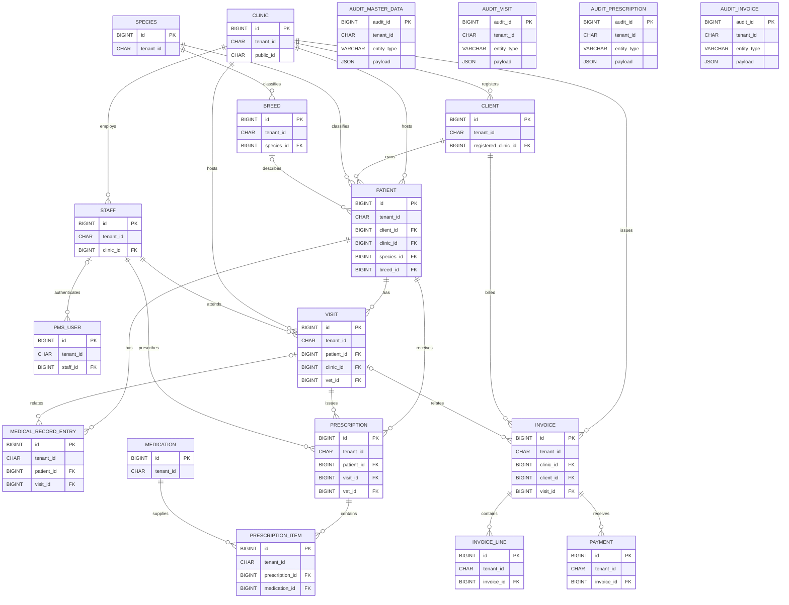
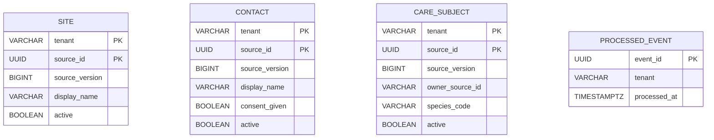

# Implemented database schemas

These diagrams reflect the checked-in Flyway migrations. They show implemented tables and declared foreign-key relationships, not the full column/index definitions. PMS business relationships are tenant-scoped: foreign keys include `tenant_id`, and each referenced `(tenant_id, id)` pair is unique.

## PMS MySQL

Source: `services/pms-api/src/main/resources/db/migration/V1__create_shared_pms_schema.sql`, `V2__create_audit_streams_and_triggers.sql`, and `V3__create_pms_users.sql`.

Audit rows are snapshots and have no foreign-key constraints to business rows. The stream tables capture:

| Audit table | Triggered entities |
|-------------|--------------------|
| `audit_master_data` | `clinic`, `client`, `patient` |
| `audit_visit` | `visit`, `medical_record_entry` |
| `audit_prescription` | `prescription`, `prescription_item` |
| `audit_invoice` | `invoice`, `invoice_line`, `payment` |

`staff`, `species`, `breed`, and `medication` are not currently written to these audit streams. The sync service currently consumes only `audit_master_data`.

## Action Engine PostgreSQL

Source: `services/action-engine/src/main/resources/db/migration/V1__create_action_engine_domain.sql`.

The Action Engine has no foreign keys between these initial tables. `care_subject.owner_source_id` stores the source contact identifier; it is not a PostgreSQL foreign key. Treatment, care-event, receivable, action, and action-attempt tables are not implemented.
